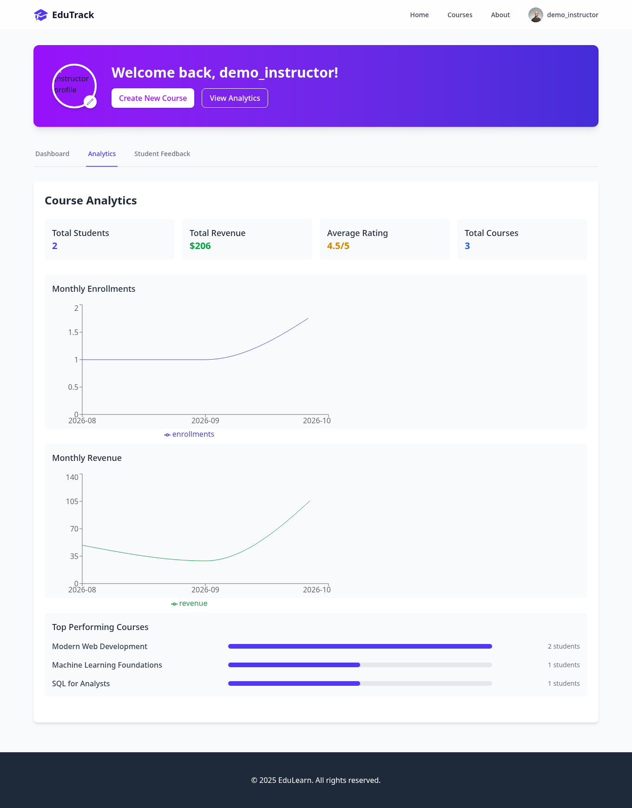
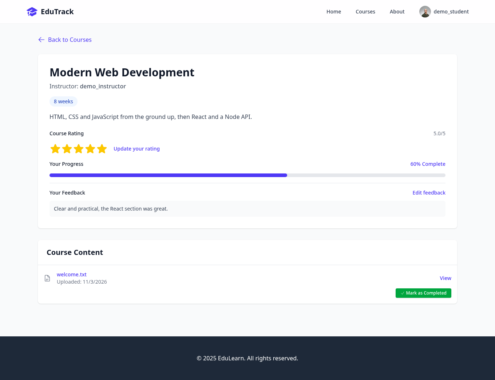
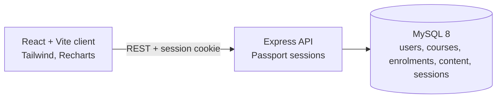

# EduTrack

A small online-learning platform. Instructors publish courses and upload materials; students browse, enrol, track progress, rate courses and leave feedback; instructors see analytics and student feedback on a dashboard.

[](https://github.com/Abdul-Wahab-17/EduTrack/actions/workflows/ci.yml)
[](LICENSE)



## Features

- **Two roles.** Students and instructors register and log in with a salted PBKDF2-HMAC-SHA256 password hash (310,000 rounds) and a MySQL-backed session.
- **Instructors:** create and edit courses (draft or published), upload files, see **analytics** (students, revenue, average rating, monthly enrolments and revenue, top courses) and read **student feedback**.
- **Students:** browse and enrol in published courses, open course files, track progress, rate courses 1–5 and leave feedback.
- **Access control:** course files can only be opened by the course's instructor and its enrolled students. Only the owner can edit or delete a course, and a course with active students cannot be deleted.

| Student dashboard | Course page |
|---|---|
|  |  |

## Quick start

```bash
docker compose up --build
```

Open **http://localhost:3000**. The first start creates the schema and demo data:

| Login | Role | Password |
|---|---|---|
| `demo_instructor` | instructor, with 3 courses | `demo1234` |
| `demo_student` | student, enrolled in 2 courses | `demo1234` |

The API is on `http://localhost:8080`. Copy `.env.example` to `.env` to change the database password or the session secret.

## Run without Docker

You need Node 22+ and MySQL 8.

```bash
mysql -u root -p < server/db/schema.sql      # create the database and tables

cd server && npm install
DB_PASSWORD=<your password> npm run seed     # optional demo data
DB_PASSWORD=<your password> npm start        # http://localhost:8080

cd ../client && npm install && npm start     # http://localhost:3000
```

## Configuration

| Variable | Default | Used by | Purpose |
|---|---|---|---|
| `DB_HOST`, `DB_PORT`, `DB_USER`, `DB_PASSWORD`, `DB_NAME` | `localhost`, `3306`, `root`, empty, `edutrack` | server | MySQL connection |
| `SESSION_SECRET` | dev-only value | server | Signs session cookies. **Required** when `NODE_ENV=production`. |
| `CLIENT_ORIGIN` | `http://localhost:3000` | server | Origin allowed by CORS |
| `PORT` | `8080` | server | API port |
| `VITE_API_URL` | `http://localhost:8080` | client (build time) | Where the browser finds the API |

## Tests

The API tests run against a real MySQL (the schema must be loaded):

```bash
docker compose up -d db              # MySQL on localhost:3307
cd server && npm install
DB_HOST=127.0.0.1 DB_PORT=3307 DB_PASSWORD=edutrack npm test
cd ../client && npm run lint && npm run build
```

They cover registration and login, role checks, uploads, who may open course content, enrolment, ratings and feedback, the analytics numbers and the delete rules.

## Architecture



```text
client/   React single-page app
server/   Express API: routes/ (auth, courses, content, data, analytics), middleware/, db/ (schema, seed), tests/
```

Uploaded files are stored in the database (`content.file_data`). That keeps the demo self-contained but is not meant for large files.

## License

[MIT](LICENSE) © 2026 Abdul Wahab
